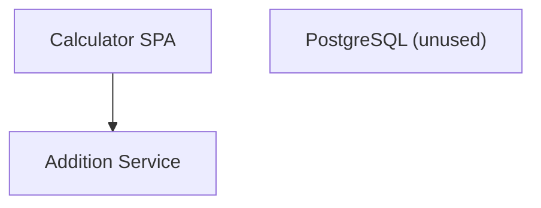
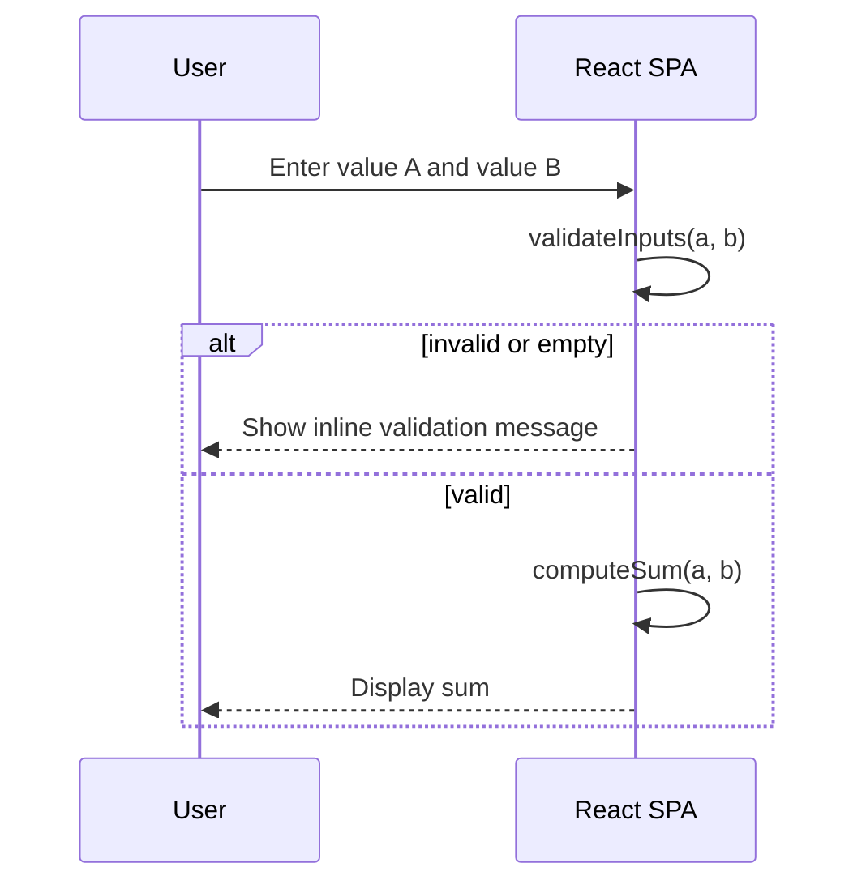
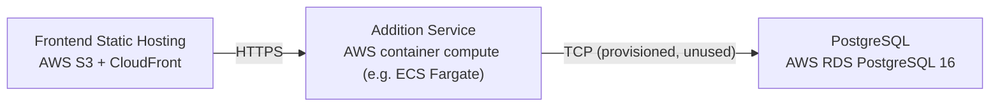

# Architecture

> Maintained by QuorQ AI SDLC. Text between `sdlc:auto` markers is regenerated; anything outside them is yours and is kept.

<!-- sdlc:auto:start narrative -->
## Overview

### ARCH-000 · approved · source: architecture:summary

Overall architecture (v1) is approved: a single-page React app performs addition client-side for instant feedback, with an optional thin FastAPI service, an intentionally unused PostgreSQL database, and AWS-based static/container hosting.

Architecture v1, status approved. Summary: lightweight public addition calculator delivered as a single React 19 page (two numeric inputs, inline validation, instant sum display). Addition runs client-side; an optional thin FastAPI 0.115 service exposes a stateless /add endpoint and a health check purely to match the platform's standard deployment shape. Nothing is persisted -- PostgreSQL 16 is provisioned only to satisfy the project template's mandatory database decision and is never written to. Deployment targets AWS: S3/CloudFront for the static frontend, a small container for the optional FastAPI service. No accounts, history, or authentication exist.

**Related:** EPIC-001, EPIC-002

### ARCH-001 · approved · source: architecture:component.frontend

React 19 single-page app renders the two inputs, performs inline validation, supports decimals/negatives, computes the sum client-side, and shows usage instructions.

Component: frontend -- Calculator SPA (React 19). Single-page UI with two numeric inputs, inline validation for non-numeric/empty values, decimal and negative support, instant sum display, and brief usage instructions. Performs addition client-side. Tech decision rationale: a page this small (two inputs + sum) needs only client-side UI; React 19 renders inputs, runs validation, and computes the sum in-browser for instant results without a routing/server layer (Next.js was explicitly rejected as unnecessary).

**Related:** EPIC-001, EPIC-002, US-001, US-002, US-003, US-005, US-006

### ARCH-002 · approved · source: architecture:component.backend

FastAPI 0.115 provides an optional, stateless /add endpoint and /health check, included mainly to match the platform's standard deployment shape rather than to satisfy a real functional need.

Component: backend -- Addition Service (FastAPI 0.115). Thin stateless API offering an optional /add endpoint and a /health check. Performs no persistence and holds no state. Rationale: the math itself can happen entirely in the browser (no real server need), but a thin FastAPI service keeps the project consistent with the platform's standard deployment shape and gives a predictable place to add server-side logic later if ever needed.

**Related:** US-001, US-004

- ⚠ Not yet determined (no dev/test input) whether the frontend will actually call /add in practice or rely purely on client-side computation; requirements (AC-009) allow either path.

### ARCH-003 · approved · source: architecture:component.database

PostgreSQL 16 is provisioned only because the project template mandates a database decision; the application defines no schema and writes nothing to it.

Component: database -- PostgreSQL (unused), PostgreSQL 16. Provisioned to satisfy the project template's database requirement. The application stores no inputs or results and never writes to it, consistent with the stateless-by-design requirement (US-004, AC-008, AC-009).

**Related:** US-004

### ARCH-004 · approved · source: architecture:tech_decision.cloud

AWS hosts the static frontend via S3/CloudFront and runs the optional FastAPI service in a small container, matching the needs of a public, stateless, single-page tool.

Cloud decision: AWS. Rationale: a public, stateless, single-page tool needs very little from a cloud provider -- static hosting plus a lightweight container for the optional backend. AWS covers this via S3/CloudFront for the frontend and a small compute service for FastAPI, without locking into anything exotic.

**Related:** EPIC-002, US-005
<!-- sdlc:auto:end narrative -->

<!-- sdlc:auto:start building-blocks -->
## Building Block View

| ID | Name | Technology | Responsibility | Depends on |
|---|---|---|---|---|
| frontend | Calculator SPA | React 19 | Single-page UI with two numeric inputs, inline validation for non-numeric/empty values, decimal and negative support, instant sum display, and brief usage instructions. Performs addition client-side. | backend |
| backend | Addition Service | FastAPI 0.115 | Thin stateless API offering an optional /add endpoint and a /health check. Performs no persistence and holds no state. | — |
| database | PostgreSQL (unused) | PostgreSQL 16 | Provisioned to satisfy the project template's database requirement. The application stores no inputs or results and never writes to it. | — |

<!-- sdlc:auto:end building-blocks -->

<!-- sdlc:auto:start runtime -->
## Runtime View

### Compute and display sum

User enters two values, validation runs, and the sum is computed and shown. Invalid or empty inputs produce an inline message instead of a result.

- **Components:** frontend, backend
- **Modules:** CalculatorPage, useAddition, validation, AdditionService
- **Key functions:** parseNumber(raw), validateInputs(a, b), computeSum(a, b), addEndpoint(a, b)

<!-- sdlc:auto:end runtime -->

<!-- sdlc:auto:start deployment-view -->
## Deployment View

| Name | Service | Runtime | Scaling | Environment |
|---|---|---|---|---|
| Frontend Static Hosting | AWS S3 + CloudFront | Static React 19 build | CDN edge, auto | dev |
| Addition Service | AWS container compute (e.g. ECS Fargate) | FastAPI 0.115 on Python 3.12 (uvicorn) | Single small task | dev |
| PostgreSQL | AWS RDS PostgreSQL 16 | PostgreSQL 16 | Single small instance (unused) | dev |

| Source | Target | Protocol |
|---|---|---|
| Frontend Static Hosting | Addition Service | HTTPS |
| Addition Service | PostgreSQL | TCP (provisioned, unused) |

<!-- sdlc:auto:end deployment-view -->

<!-- sdlc:auto:start decisions -->
## Architecture Decisions

| Layer | Choice | ADR |
|---|---|---|
| Frontend | React 19 | [ADR-0001](adr/frontend.md) |
| Backend | FastAPI 0.115 | [ADR-0002](adr/backend.md) |
| Database | PostgreSQL 16 | [ADR-0003](adr/database.md) |
| Cloud | AWS | [ADR-0004](adr/cloud.md) |
<!-- sdlc:auto:end decisions -->

<!-- sdlc:auto:start links -->
## Related Documents

- [Data Model](data-model.md)
- [API Specification](api/openapi.yaml)
- [Architecture Decision Records](adr/README.md)
<!-- sdlc:auto:end links -->
